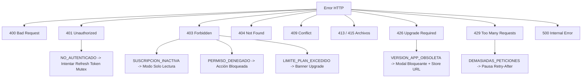

# Catálogo Canónico de Errores del Backend (Hito 11D - ADR-015)

Este documento define la totalidad de los códigos de error de dominio emitidos por la API del Sistema de Rentabilidad Agrícola, sus códigos de estado HTTP asociados, la estructura de detalles y la conducta de resolución requerida en clientes móviles (Flutter).

---

## 1. Estructura Estándar de Respuesta de Error

Todos los errores retornados por la API (salvo excepciones a nivel de proxy o gateway) cumplen con el siguiente sobre unificado (`ErrorResponseDto`):

```json
{
  "statusCode": 400,
  "code": "VENTA_EXCEDE_DISPONIBLE",
  "message": "Los kilogramos netos que se intentan vender exceden el inventario disponible de la cosecha.",
  "details": {
    "disponible": "1500.00",
    "solicitado": "2000.00"
  }
}
```

### Cabeceras HTTP Asociadas
- `x-correlation-id`: Identificador único de trazabilidad de la petición. Ante cualquier error 500 o incidencia operativa, Flutter debe registrar este identificador para soporte y telemetría.
- `Retry-After`: En respuestas `429 DEMASIADAS_PETICIONES`, indica el número entero de segundos que el cliente debe esperar antes de reintentar la solicitud.

---

## 2. Catálogo Exhaustivo de Códigos de Error (`CodigoError`)

| Código | HTTP Status | Causa Funcional | Payload en `details` | Conducta / Reacción en Cliente Flutter |
|---|:---:|---|---|---|
| `CICLO_CERRADO` | 400 | El ciclo agrícola se encuentra cerrado; no admite inserciones o ediciones de actividades, gastos o cosechas. | Opcional | Bloquear formularios de captura asociados a dicho ciclo y reflejar el estado "Cerrado" en la interfaz. |
| `CICLO_YA_ACTIVO` | 400 | La parcela ya cuenta con un ciclo agrícola en estado `ACTIVO`. | Opcional | Deshabilitar botón "Iniciar Ciclo" en la parcela hasta que el ciclo en curso sea cerrado. |
| `VENTA_EXCEDE_DISPONIBLE` | 400 | Los kilogramos netos a vender superan el remanente disponible de la cosecha. | `{ disponible, solicitado }` | Validar en formulario contra `disponible` antes del envío y mostrar alerta con el remanente real. |
| `MERMA_EXCEDE_COSECHA` | 400 | Los kilogramos de merma declarados superan el remanente neto de la cosecha. | `{ remanente, merma }` | Restringir el límite máximo del input numérico en la pantalla de registro de merma. |
| `TOTAL_NO_COINCIDE` | 400 | El importe monetario total enviado no coincide con el cálculo matemático (volumen × precio). | Opcional | Recalcular automáticamente en el cliente antes del envío utilizando aritmética fija de 2 decimales. |
| `COBRO_EXCEDE_TOTAL` | 400 | El monto del cobro excede el saldo pendiente de la venta. | `{ saldoPendiente, montoCobro }` | Fijar el tope máximo del campo de cobro al saldo pendiente actual de la venta. |
| `VENTANA_EDICION_VENCIDA` | 400 | Han transcurrido más de 72 horas desde la captura del registro; la ventana reglamentaria de edición ha expirado. | Opcional | Ocultar botones de edición y anulación cuando la fecha de captura supere las 72 horas. |
| `LIMITE_PLAN_EXCEDIDO` | 403 | La empresa ha alcanzado el límite máximo de su suscripción (parcelas activas, usuarios, etc.). | `{ recurso, limite, actual }` | Desplegar pantalla informativa invitando al administrador a actualizar su plan de suscripción. |
| `SUSCRIPCION_INACTIVA` | 403 | La suscripción de la empresa está vencida, cancelada o suspendida (RN-038). | Opcional | Activar modo solo lectura (permitir GET, bloquear POST/PUT/PATCH/DELETE). **NUNCA** intentar refresco de sesión ante este error. |
| `PERMISO_DENEGADO` | 403 | El rol del usuario carece del permiso atómico requerido para el endpoint. | `{ permisosRequeridos }` | Ocultar o deshabilitar elementos de navegación y acciones no autorizadas. No reintentar la petición. |
| `FECHA_ANTERIOR_AL_INICIO` | 400 | La fecha de la actividad, gasto o cosecha es previa a la fecha de inicio del ciclo. | Opcional | Restringir el `DatePicker` para que la fecha mínima seleccionable sea la fecha de inicio del ciclo. |
| `UNIDAD_NO_PESO` | 400 | Se intentó registrar una cosecha o merma con una unidad que no mide masa/peso. | Opcional | Filtrar el catálogo de unidades de medida para mostrar únicamente unidades de peso (KG, TON). |
| `ACTIVIDAD_DE_OTRO_CICLO` | 400 | Se asoció un gasto a una actividad que pertenece a un ciclo agrícola distinto. | Opcional | Filtrar actividades por el ciclo agrícola activo en el selector del formulario. |
| `CICLO_NO_ACTIVO` | 400 | La operación exige un ciclo en estado `ACTIVO`, pero se encuentra en `PLANIFICADO` o `CERRADO`. | Opcional | Permitir capturas únicamente cuando el ciclo seleccionado presente estado `ACTIVO`. |
| `COSECHA_DE_OTRO_CICLO` | 400 | La cosecha seleccionada no pertenece al ciclo agrícola de la operación. | Opcional | Filtrar cosechas por el ciclo actualmente seleccionado. |
| `COSECHA_CON_MERMAS_VIGENTES` | 400 | No es posible anular la cosecha porque tiene mermas activas registradas. | Opcional | Alertar al usuario que debe anular primero las mermas asociadas a la cosecha. |
| `VENTA_YA_CANCELADA` | 400 | La venta ya se encuentra en estado `CANCELADA`; no permite cobros ni modificaciones. | Opcional | Deshabilitar botón "Cobrar" y opciones de modificación en ventas canceladas. |
| `CLIENTE_NO_ACTIVO` | 400 | El cliente seleccionado está inactivo en el catálogo. | Opcional | Excluir clientes inactivos del selector desplegable de ventas. |
| `COSECHA_CON_VENTAS_VINCULADAS` | 400 | No se puede anular la cosecha porque existen ventas activas vinculadas a su volumen. | Opcional | Informar que deben cancelarse las ventas asociadas antes de poder anular la cosecha. |
| `KG_VENDIDOS_EXCEDEN_NETOS` | 400 | Los kilogramos netos de la venta exceden el total neto disponible de la cosecha. | Opcional | Validar en la interfaz el volumen remanente antes de confirmar la venta. |
| `RECURSO_NO_ENCONTRADO` | 404 | El recurso solicitado no existe o fue eliminado lógicamente. | Opcional | Mostrar mensaje "El registro no fue encontrado", recargar la lista o regresar a la pantalla anterior. |
| `PETICION_INVALIDA` | 400 | Falla en validaciones de formato, campos obligatorios o tipos de datos (class-validator). | Array de errores de validación | Mapear mensajes de validación a los campos correspondientes del formulario. |
| `NO_AUTENTICADO` | 401 | Access Token ausente, expirado (15 min) o inválido. | Opcional | **Disparar flujo de refresco de sesión vía Mutex único**. Si el refresco falla con 401, redirigir a Login. |
| `COBRO_YA_ANULADO` | 400 | El cobro ya se encuentra en estado `ANULADO`. | Opcional | Deshabilitar la opción de anulación en cobros previamente anulados. |
| `FECHA_COBRO_INVALIDA` | 400 | La fecha de cobro es anterior a la fecha de venta o posterior a la fecha actual. | Opcional | Restringir el `DatePicker` entre la fecha de emisión de la venta y la fecha de hoy. |
| `ARCHIVO_DEMASIADO_GRANDE` | 413 | El archivo adjunto supera el tamaño máximo permitido de 10 MB. | Opcional | Verificar el tamaño del archivo localmente antes de iniciar la subida y alertar si excede 10 MB. |
| `TIPO_ARCHIVO_NO_PERMITIDO` | 415 | La extensión o los Magic Bytes del archivo no están permitidos (permitidos: PDF, PNG, JPEG, WEBP). | Opcional | Restringir el selector de archivos del dispositivo a extensiones permitidas. |
| `ADJUNTO_ENTIDAD_NO_SOPORTADA` | 400 | La entidad indicada en la subida del adjunto no soporta almacenamiento de archivos. | Opcional | Asegurar que el parámetro de entidad corresponda a las permitidas en la UI. |
| `ENLACE_DESCARGA_INVALIDO` | 400 | El token de descarga firmada expiró (TTL 300s), está corrupto o la firma HMAC es inválida. | Opcional | Solicitar un nuevo enlace firmado mediante `GET /api/v1/adjuntos/:id/enlace-descarga`. |
| `LIMITE_ADJUNTOS_ALCANZADO` | 400 | Se ha alcanzado el límite máximo de adjuntos permitidos para la entidad. | Opcional | Deshabilitar el botón de adjuntar archivos informando que se alcanzó el cupo máximo. |
| `EXPORTACION_EXCEDE_LIMITE` | 400 | La solicitud de exportación supera el umbral máximo de 10,000 registros. | Opcional | Solicitar al usuario acotar el rango de fechas o seleccionar parcelas específicas. |
| `DEMASIADAS_PETICIONES` | 429 | Se ha excedido la tasa límite de peticiones (Rate Limiting). | `{ retryAfter }` | Pausar peticiones salientes durante los segundos especificados en `Retry-After` y mostrar mensaje. |
| `VERSION_APP_OBSOLETA` | 426 | La versión instalada de Flutter es inferior a la requerida por el servidor (`MIN_APP_VERSION`). | `{ minVersion, clientVersion, storeUrl }` | **Mostrar pantalla modal bloqueante** que impida continuar y ofrezca un botón para abrir `storeUrl`. |
| `VERSION_APP_INVALIDA` | 400 | El valor enviado en la cabecera `X-App-Version` no cumple con la especificación SemVer (ej. `1.0.0`). | `{ clientVersion }` | Asegurar que Flutter envíe la versión extraída de `package_info_plus` en formato SemVer limpio. |
| `CONFLICTO` | 409 | Conflicto de concurrencia o unicidad en la base de datos (clave duplicada o dependencia foránea). | Opcional | Notificar al usuario que la información ya fue registrada o actualizada por otro proceso; refrescar vista. |
| `TOKEN_RECUPERACION_INVALIDO` | 400 | El token de recuperación de contraseña es inexistente, expiró (TTL 15 min), ya fue utilizado o fue revocado. | Opcional | Notificar al usuario que el enlace no es válido y ofrecerle solicitar uno nuevo. |
| `CONTRASENA_ACTUAL_INCORRECTA` | 400 | La contraseña actual proporcionada para el cambio autenticado no coincide con la registrada. | Opcional | Limpiar campo de contraseña actual y solicitar al usuario verificarla. |
| `ERROR_INTERNO` | 500 | Error no controlado en el servidor. | Opcional | Mostrar mensaje general de error y proveer el `x-correlation-id` para asistencia técnica. |

---

## 3. Matriz de Clasificación por Código de Estado HTTP


